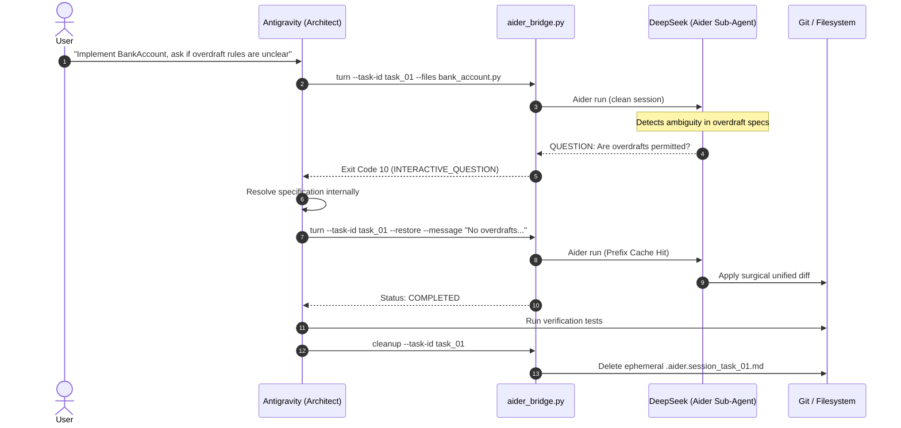

# Aider-DeepSeek Antigravity Skill

[](https://github.com/JMartynov/deepseek-aider-antigravity/actions)

A production-ready Antigravity skill that enables **Google Antigravity** (acting as Lead Architect) to delegate coding and testing tasks to **DeepSeek V3 / Flash** via Aider CLI in **ultra token-sparse mode**.

## Why This Skill?

- **Token-Sparse by Design**: Uses `deepseek/deepseek-chat` with surgical unified diffs (`edit-format: diff`), disabled repository maps (`map-tokens: 0`), and prompt caching (`cache-prompts: true`).
- **Interactive Turn Emulation**: Allows DeepSeek to halt on ambiguous requirements using `QUESTION: <question>`, enabling Antigravity to intercept questions, provide architectural decisions, and resume under DeepSeek's **server-side prefix cache** (~90% cost reduction).
- **Zero Process Leaks**: Stateless per-turn invocations with session state recorded in ephemeral `.aider.session_<id>.md` files, cleanly purged on task completion.
- **Strict Secrets Isolation**: `DEEPSEEK_API_KEY` is loaded strictly from the target project's `.env` file and never leaked or committed.

---

## Repository Structure

```
├── SKILL.md                 # Antigravity skill specification (global skill entrypoint)
├── scripts/
│   └── aider_bridge.py      # Core Python bridge orchestrator
├── tests/
│   └── test_skill.py        # Automated test suite validating the skill logic
├── examples/
│   ├── bank_account.py      # Sample domain code generated by DeepSeek
│   └── test_bank_account.py # PyTest suite generated by DeepSeek
└── README.md
```

---

## Installation

To install this skill globally for your Antigravity environment:

```bash
mkdir -p ~/.gemini/config/skills/aider-deepseek
git clone https://github.com/JMartynov/deepseek-aider-antigravity.git ~/.gemini/config/skills/aider-deepseek
```

Ensure `uv` is installed on your system:
```bash
which uv || curl -LsSf https://astral.sh/uv/install.sh | sh
```

---

## Verification & Automated Tests

All functionality is backed by test suites in `tests/`:

```bash
uv run --with pytest pytest tests/ -v
```

Tests cover:
1. **Token & Cost Parsing**: Extraction of metrics from sub-agent runs.
2. **Environment Isolation**: Secure loading of `.env` files.
3. **Question Intercept**: Detection of the `QUESTION:` stop-word returning exit code `10`.
4. **Lifecycle & Cleanup**: Reliable deletion of ephemeral session markdown files.
5. **Generated Artifact Verification**: Execution of code generated in the examples directory.

---

## How It Works (Turn Lifecycle)


