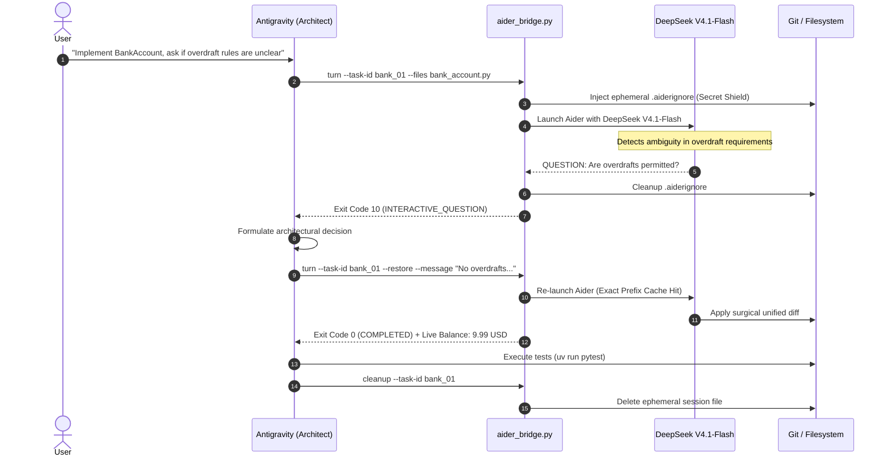

# Aider-DeepSeek Antigravity Skill

[](https://github.com/JMartynov/deepseek-aider-antigravity/actions)
[](https://opensource.org/licenses/MIT)

A high-performance, token-sparse sub-agent harness connecting **Google Antigravity** (Lead Architect) to **DeepSeek V4.1-Flash** via the Aider CLI engine.

Designed for intense daily programming workflows (up to 5 hours/day) while strictly keeping API costs under **$10/month** through DeepSeek hardware prefix-caching, surgical diff edits, secret shielding, and automated turn-based dialogue.

---

## 🌟 Key Features

- **Ultra Token-Sparse by Design**: Defaults to `deepseek/deepseek-flash` with search/replace diffs (`edit-format: diff`), disabled repo-maps (`map-tokens: 0`), and keepalive pings (`cache-keepalive-pings: 6`).
- **Turn-Based Question Intercept**: If specifications are ambiguous, DeepSeek pauses with `QUESTION: <question>`, exiting cleanly with code `10`. Antigravity resolves the question and resumes the session under DeepSeek's server-side prefix cache (~90–98% discount).
- **Live Balance & Token Telemetry**: Automatically queries `https://api.deepseek.com/user/balance` after every turn, logging tokens sent, cache hits, turn cost, session cost, and live account balance.
- **Dynamic Secret Shield (`.aiderignore`)**: Injects an ephemeral `.aiderignore` before each run, ensuring `.env*`, `*.pem`, `*.key`, `node_modules/`, and cache directories are never passed to the remote LLM.
- **Atomic Rollback on Diff Collisions**: Automatically reverts modified tracked files via `git checkout` and purges incomplete untracked files if an edit fails to apply.
- **Universal Auto-Lint**: Defaults to `python:python -m py_compile` (or custom `--lint-cmd`) so DeepSeek catches and self-heals syntax errors within the same turn.
- **Read-Only Scope Protection**: Supports `--read-files` to open reference schemas and interfaces with `--read`, preventing accidental edits to read-only code.

---

## 📂 Repository Structure

```
├── SKILL.md                     # Antigravity skill specification (global skill entrypoint)
├── scripts/
│   └── aider_bridge.py          # Core Python bridge orchestrator
├── tests/
│   ├── test_skill.py            # Baseline tests (env loading, balance API, session cleanup)
│   ├── test_parsing_robustness.py # Robustness tests for token/cache/cost metrics
│   ├── test_question_protocol.py# Multi-line & code-block question disambiguation tests
│   ├── test_multi_turn_diffs.py # Diff collision & edit failure verification tests
│   ├── test_multi_file_scope.py # Path containment & directory provisioning tests
│   └── test_harness_advanced.py# Tests for .aiderignore shield, atomic rollback, and auto-lint
├── examples/
│   ├── bank_account.py          # Domain code generated by DeepSeek
│   └── test_bank_account.py     # 11 unit tests generated across interactive turns
├── .github/workflows/
│   └── test.yml                 # CI test runner
└── README.md
```

---

## 🚀 Quick Start & Installation

### 1. Install Skill Globally

Clone this repository into your Antigravity skills directory:

```bash
mkdir -p ~/.gemini/config/skills/aider-deepseek
git clone https://github.com/JMartynov/deepseek-aider-antigravity.git ~/.gemini/config/skills/aider-deepseek
```

Ensure `uv` is available on your path:
```bash
which uv || curl -LsSf https://astral.sh/uv/install.sh | sh
```

### 2. Configure Your Project

In any project where you want to use the sub-agent, add your key to `.env`:

```bash
echo 'DEEPSEEK_API_KEY="sk-your-key-here"' >> .env
echo '.env' >> .gitignore
```

---

## 📖 End-to-End Orchestrator Workflow



---

## 💻 CLI Reference & Examples

The runner is invoked as a standard CLI tool:

### 1. Standard Turn
```bash
python3 scripts/aider_bridge.py turn \
  --task-id "<task_id>" \
  --message "<task_contract>" \
  --files <editable_file1> <editable_file2> \
  --read-files <readonly_interface> \
  --cwd "<project_dir>"
```

### 2. Resuming an Interactive Session
When the sub-agent pauses with `QUESTION:` (exit code `10`):
```bash
python3 scripts/aider_bridge.py turn \
  --task-id "<task_id>" \
  --restore \
  --message "Architect Answer: <clarification>. Proceed with implementation." \
  --files <editable_file1> \
  --cwd "<project_dir>"
```

### 3. Session Cleanup
When verification passes:
```bash
python3 scripts/aider_bridge.py cleanup \
  --task-id "<task_id>" \
  --cwd "<project_dir>"
```

---

## 🧪 Automated Testing & CI

Every invariant and failure mode is guarded by automated test suites in `tests/`:

```bash
uv run --with pytest pytest tests/ -v
```

```text
============================== 24 passed in 5.80s ==============================
```

Tests cover:
- **Token & Cache Regex**: Verifies parsing across `cache write`, `cache hit`, and sub-cent costs.
- **Diff False-Positive Immunity**: Verifies code comments containing `QUESTION:` in diffs are never falsely intercepted.
- **Multi-Line Questions**: Extracts complex questions containing options and code snippets.
- **Collision Detection**: Detects failed search/replace blocks and triggers exit code `11`.
- **Atomic Rollback**: Tests rollback of tracked files (`git checkout`) and deletion of untracked files on failure.
- **Secret Shield**: Verifies ephemeral `.aiderignore` creation, pattern matching, and cleanup.
- **Live Balance API**: Mock tests for `https://api.deepseek.com/user/balance`.

---

## 💰 Real-World Token Economics ($10/month Budget)

Live metrics recorded during the 3-turn interactive demo:

| Step | Operation | Tokens Sent | Cache Hit | Tokens Recv | Cost (USD) |
| :--- | :--- | :--- | :--- | :--- | :--- |
| **Turn 1** | Ambiguity Check | 2,500 | 0 | 55 | **$0.00071** |
| **Turn 2** | Code Implementation | 2,800 | ~2,500 | 109 | **$0.00082** |
| **Turn 3** | Test Suite Generation | 3,100 | ~2,800 | 289 | **$0.00100** |
| **Total** | **Feature + 11 Tests** | | | | **$0.00253** |

At **~$0.0025** per full feature cycle, 40 iterations per day for 30 days costs **~$3.00/month**, easily staying within the **$10/month** limit.

---

## 📄 License

MIT License. Free for open-source and commercial use.
