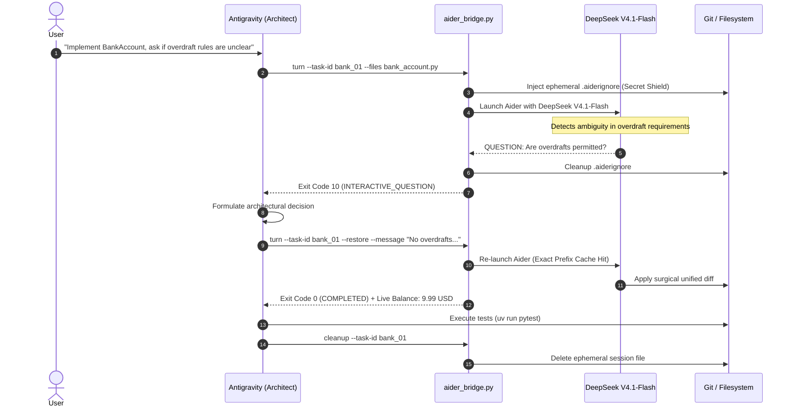

# Aider-DeepSeek Antigravity Skill

[](https://github.com/JMartynov/deepseek-aider-antigravity/actions)
[](https://opensource.org/licenses/MIT)

A high-performance, token-sparse sub-agent harness connecting **Google Antigravity** (Lead Architect) to **DeepSeek V4.1-Flash** via the Aider CLI engine.

Designed for intense daily programming workflows (up to 5 hours/day) while strictly keeping API costs under **$10/month** through DeepSeek hardware prefix-caching, surgical diff edits, secret shielding, and automated turn-based dialogue.

---

## 🌟 Key Features

- **Ultra Token-Sparse by Design**: Defaults to `deepseek/deepseek-flash` with search/replace diffs (`edit-format: diff`), disabled repo-maps (`map-tokens: 0`), and keepalive pings (`cache-keepalive-pings: 6`).
- **Turn-Based Question Intercept**: If specifications are ambiguous, DeepSeek pauses with `QUESTION: <question>`, exiting cleanly with code `10`. Antigravity resolves the question and resumes the session under DeepSeek's server-side prefix cache (~90–98% discount).
- **Live Balance & Token Telemetry**: Automatically queries `https://api.deepseek.com/user/balance` after every turn, logging tokens sent, cache hits, turn cost, session cost, and live account balance.
- **Dynamic Secret Shield (`.aiderignore`)**: Injects an ephemeral `.aiderignore` before each run, ensuring `.env*`, `*.pem`, `*.key`, `node_modules/`, cache directories, bulk data/lockfile/JSON payloads (`docs/data/`, `data/`, `*.csv`, `*.parquet`, `*.json`, `uv.lock`, `package-lock.json`, `pnpm-lock.yaml`, `yarn.lock`, `web/catalog.json`), and any unrequested file >100 KB are never passed to the remote LLM (explicit `--files`/`--read-files` are re-exempted via sorted `!` negations).
- **Cost-Saving Guards**: `turn` defaults to `--thinking off` (dispatch Tiers 2/3 still resolve `auto`/`low` and `on`/`high`), and a hard context-budget circuit breaker — `--max-context-kb` (default `128`) with `--allow-large-context` to bypass — exits `14` (`PREFLIGHT_FAILED`) before calling DeepSeek when the deduplicated `--files` + `--read-files` total exceeds the budget.
- **Atomic Rollback on Diff Collisions**: Automatically reverts modified tracked files via `git checkout` and purges incomplete untracked files if an edit fails to apply.
- **Universal Auto-Lint**: Defaults to `python:python -m py_compile` (or custom `--lint-cmd`) so DeepSeek catches and self-heals syntax errors within the same turn.
- **Read-Only Scope Protection**: Supports `--read-files` to open reference schemas and interfaces with `--read`, preventing accidental edits to read-only code.
- **Closed-Loop TDD Delegation**: `--test-cmd <cmd>` wires `--auto-test --test-cmd` so failing tests are fed back to DeepSeek for self-healing within the same turn (best combined with `--worktree`/`--no-auto-merge`).
- **Dry-Run & Architect Modes**: `--dry-run` proposes diffs without writing; `--architect` enables two-model editing where `--editor-model` defaults to `deepseek/deepseek-flash` when `--model` is `deepseek/deepseek-reasoner`.
- **Bidirectional Async Messaging & Plan Alignment**: Structured `.aider-sessions/<task_id>/` state (state.json + outbox.jsonl + inbox.jsonl), Stage-1 `--plan-align` consults, `inspect` / `reply` CLI commands, anti-noise threshold gate (boilerplate sign-offs auto-suppressed), and a strict merge guard that blocks `merge-worktree` while any decision is pending (`AWAITING_*` → exit 5).

---

## 📂 Repository Structure

```
├── SKILL.md                     # Antigravity skill specification (global skill entrypoint)
├── scripts/
│   └── aider_bridge.py          # Core Python bridge orchestrator
├── tests/
│   ├── test_skill.py            # Baseline tests (env loading, balance API, session cleanup)
│   ├── test_parsing_robustness.py # Robustness tests for token/cache/cost metrics
│   ├── test_question_protocol.py# Multi-line & code-block question disambiguation tests
│   ├── test_multi_turn_diffs.py # Diff collision & edit failure verification tests
│   ├── test_multi_file_scope.py # Path containment & directory provisioning tests
│   ├── test_harness_advanced.py # Tests for .aiderignore shield, atomic rollback, and auto-lint
│   ├── test_dispatcher_all_options.py # Dispatcher & DeepSeek options matrix tests
│   └── test_scope_gateway.py    # 2-Route Smart Pre-Task Repo Inspection Gateway tests
├── examples/
│   ├── bank_account.py          # Domain code generated by DeepSeek
│   └── test_bank_account.py     # 11 unit tests generated across interactive turns
├── .github/workflows/
│   └── test.yml                 # CI test runner
└── README.md
```

---

## 🚀 Quick Start & Installation

### 1. Install Skill Globally

Clone this repository into your Antigravity skills directory:

```bash
mkdir -p ~/.gemini/config/skills/aider-deepseek
git clone https://github.com/JMartynov/deepseek-aider-antigravity.git ~/.gemini/config/skills/aider-deepseek
```

Ensure `uv` is available on your path:
```bash
which uv || curl -LsSf https://astral.sh/uv/install.sh | sh
```

### 2. Configure Your Project

In any project where you want to use the sub-agent, add your key to `.env`:

```bash
echo 'DEEPSEEK_API_KEY="sk-your-key-here"' >> .env
echo '.env' >> .gitignore
```

---

## 📖 End-to-End Orchestrator Workflow



---

## 💻 CLI Reference & Examples

The runner is invoked as a standard CLI tool:

### 1. Standard Turn
```bash
python3 scripts/aider_bridge.py turn \
  --task-id "<task_id>" \
  --message "<task_contract>" \
  --files <editable_file1> <editable_file2> \
  --read-files <readonly_interface> \
  --cwd "<project_dir>"
```

### 2. Resuming an Interactive Session
When the sub-agent pauses with `QUESTION:` (exit code `10`):
```bash
python3 scripts/aider_bridge.py turn \
  --task-id "<task_id>" \
  --restore \
  --message "Architect Answer: <clarification>. Proceed with implementation." \
  --files <editable_file1> \
  --cwd "<project_dir>"
```

### 3. Session Cleanup
When verification passes:
```bash
python3 scripts/aider_bridge.py cleanup \
  --task-id "<task_id>" \
  --cwd "<project_dir>"
```

### 3a. Inspect Session & Reply (Bidirectional Protocol)

```bash
# Dump current state + latest pending question
python3 scripts/aider_bridge.py inspect --task-id "<task_id>" --cwd "<project_dir>"
python3 scripts/aider_bridge.py inspect --task-id "<task_id>" --json --cwd "<project_dir>"

# Answer and resume (prefix cache preserved; system_rules NOT re-prepended on Turn 2+)
python3 scripts/aider_bridge.py reply \
  --task-id "<task_id>" \
  --answer "Use Redis JTI revocation set, inject RedisClient Protocol" \
  --approved-option B \
  --cwd "<project_dir>"
```

Session artifacts (git-ignored):

```
.aider-sessions/<task_id>/
├── state.json         # RUNNING | AWAITING_PLAN_APPROVAL | AWAITING_DECISION | COMPLETED | FAILED
├── chat_history.md
├── outbox.jsonl       # Structured questions DeepSeek → Principal
└── inbox.jsonl        # Principal → DeepSeek decisions
```

### 3b. Stage 1 Plan Alignment (`--plan-align`)

```bash
python3 scripts/aider_bridge.py turn \
  --task-id "<task_id>" --message "Plan the refactor" --files feature.py \
  --plan-align \
  --cwd "<project_dir>"
```

Opt-in only (not auto-enabled on Tier 3). Forbids file edits — DeepSeek analyzes scope and emits a structured `QUESTION: [STAGE: PLANNING] …`; Stage 1 omits the surgical-diff rule and never fails with `DIFF_APPLY_FAILED` on read-only output. Session state becomes `AWAITING_PLAN_APPROVAL`; use `reply` to resolve, then `merge-worktree`.

### Structured `QUESTION:` Contract

```text
QUESTION: [STAGE: PLANNING|IMPLEMENTATION] [CATEGORY: ARCHITECTURE|SCHEMA|...] [IMPACT: HIGH]
<concise technical inquiry>
[OPTIONS:
  A) ...
  B) ...
]
[RECOMMENDATION: Option A]
```

### Anti-Noise Threshold Gate

| Verdict | Trigger | Action |
| :--- | :--- | :--- |
| `AUTO_SUPPRESS` | `Should I proceed?`, `Would you like me to…`, `IMPACT: LOW` | Auto-reply locally once; 0 principal tokens |
| `ESCALATE_PRINCIPAL` | `[STAGE: PLANNING]`, `ARCHITECTURE`, `SCHEMA`, `BREAKING_CHANGE`, `SECURITY`, `AMBIGUITY`, `UNRESOLVABLE_FAILURE`, `IMPACT: HIGH`, or substantive unstructured | Write to `outbox.jsonl`, exit `10` |

### 4. Advanced Turn Options
```bash
# Closed-loop TDD inside an isolated worktree
python3 scripts/aider_bridge.py turn \
  --task-id "<task_id>" \
  --message "Implement feature and make tests pass." \
  --files feature.py \
  --test-cmd "uv run pytest tests/test_feature.py -q" \
  --worktree --no-auto-merge \
  --cwd "<project_dir>"

# Dry-run plan review (no disk writes)
python3 scripts/aider_bridge.py turn \
  --task-id "<task_id>" --message "Plan refactor." --files feature.py --dry-run \
  --cwd "<project_dir>"

# Architect mode (editor defaults to deepseek/deepseek-flash with reasoner model)
python3 scripts/aider_bridge.py turn \
  --task-id "<task_id>" --message "Design and implement." --files feature.py \
  --model deepseek/deepseek-reasoner --architect \
  --cwd "<project_dir>"

# Stage 1 planning (no edits, escalate structural choice)
python3 scripts/aider_bridge.py turn \
  --task-id "<task_id>" --message "Plan auth module" --files auth.py --plan-align \
  --cwd "<project_dir>"
```

- **Exit `5` (`MERGE_BLOCKED`)** — `merge-worktree` was blocked because `state.json` status is `AWAITING_*`; call `reply` first.
- **`--message-file <path>`** — read the task message from a UTF-8 file instead of `--message` (avoids shell backtick/escaping mangling); supported by `turn` and `dispatch`.

### Web Search Delegation

Research external APIs up front instead of burning reasoning tokens on invalid hypotheses:

```bash
python3 scripts/aider_bridge.py search --cwd "<project_dir>" \
  --count 10 --need-content "OpenAI Responses API tool schema"
```

Feed the resulting summary/URLs back into your task prompt or `--read-files` contract. Exit codes: `16` (429 rate limit), `17` (API error), `18` (network), `19` (invalid response).

### Smart Dispatcher (Auto Tier Routing)

The `dispatch` subcommand classifies a task and selects the optimal model / thinking / edit-format automatically:

```bash
# Dry-run: print the classification verdict + resolved parameters (no execution)
python3 scripts/aider_bridge.py dispatch \
  --task-id "<task_id>" --message "Fix typo in README" --files README.md \
  --dry-run --cwd "<project_dir>"

# Execute the matched tier
python3 scripts/aider_bridge.py dispatch \
  --task-id "<task_id>" --message "Implement verify_token" --files auth.py \
  --test-cmd "uv run pytest tests/test_auth.py -q" --worktree --cwd "<project_dir>"
```

| Tier | Label | Trigger | Model / Thinking | Test-Cmd |
| :---: | :--- | :--- | :--- | :--- |
| 1 | `PATCH` | Any number of doc/config-only files (`.md/.txt/.rst/.toml/.yaml/.yml/.json/.ini/.cfg`) or patch keywords (typo, lint, bump, version, docstring, comment, readme, format, rename); no `--test-cmd` — takes precedence over file-count/architect keywords unless `--tier architect` is forced | `deepseek-flash` / `off` | off |
| 2 | `SURGICAL` | 1–5 non-doc files, localized work, or active `--test-cmd` | `deepseek-flash` / `auto` (low) | active |
| 3 | `ARCHITECT` | >5 non-doc files or complex/AST/concurrency keywords | `deepseek-reasoner` + `flash` editor / `on` (high) | active |
| 4 | `RESEARCH` | No editable files with research intent, or no `--test-cmd` | DeepSeek `search` API | n/a |

Flags: `--tier {auto,patch,surgical,architect,research}`, `--model`, `--editor-model`, `--architect`, `--thinking {auto,on,off}`, `--reasoning-effort {low,high,max}`, `--map-tokens`, `--lint-cmd`, `--test-cmd`, `--dry-run`, `--worktree`, `--no-auto-merge`, `-v/--verbose`, `--plan-align`, `--message-file <path>`, `--restore` (resumes a session on dispatch), `--auto-scope` (auto-run `scope` when `--files` is omitted), `--count`, `--need-content`, `--json` (Tier 4 research).

#### 2-Route Smart Pre-Task Repo Inspection Gateway

- **Route 1 — DeepSeek `scope` / `dispatch --auto-scope`** (single-repo code tasks): runs Aider in `--chat-mode context` (`--map-tokens 1536 --map-multiplier-no-files 1`, `thinking: off`) with ephemeral data-dir shields (`.worktrees/`, `artifacts/`, `passports/`, `advisories/`, `*.json`). Returns `editable_files`, `relevant_symbols`, auto-discovered `read_files` (`tests/test_<stem>.py`, `tests/unit/test_<stem>.py`, plus bounded symbol-referencing files), `suggested_test_cmd` (`uv run pytest <test_files> -q`), `suggested_tier`, `confidence` (`high`/`low`), and token/cost metrics.
- **Route 2 — Antigravity `flash` Researcher Fallback** (cross-repo, git-history, or runtime investigations, or when Route 1 yields `confidence: "low"`): `dispatch --auto-scope` exits `14` (`PREFLIGHT_FAILED`) cleanly so the orchestrator escalates to an Antigravity `research` (`flash`) subagent.

```bash
# Route 1: Standalone repo inspection
python3 scripts/aider_bridge.py scope \
  --message "Add rate limiting to token verification" \
  --cwd "<project_dir>" --map-tokens 1536 --json \
  --model deepseek/deepseek-flash --thinking off

# Route 1: Automated scope -> classify -> dispatch
python3 scripts/aider_bridge.py dispatch \
  --task-id "<task_id>" --message "Add rate limiting to token verification" \
  --auto-scope --worktree --cwd "<project_dir>"
```

### Complete DeepSeek Options & Smart Dispatcher Reference Matrix

| Category | Option / Setting | Subcommands | What It Does | When to Use |
| :--- | :--- | :--- | :--- | :--- |
| **Models** | `--model` (`deepseek/deepseek-flash`, `deepseek/deepseek-reasoner`, `deepseek/deepseek-v4-pro`) | `turn`, `dispatch` | Selects primary model (Tier 1/2 default: `flash`; Tier 3 default: `reasoner`). | Use `flash` for fast/cheap edits; `reasoner` or `v4-pro` for deep architecture, concurrency, or AST tasks. |
| **Models** | `--editor-model` | `turn`, `dispatch` | Sets editor model in `--architect` mode (`editor-diff`, thinking disabled). Auto-defaults to `deepseek/deepseek-flash` for `reasoner` and `v4-pro`. | Leave default for cost-optimal two-model editing; override only when a specialized editor model is required. |
| **Reasoning** | `--thinking {auto,on,off}` | `turn`, `dispatch` | Controls `extra_params.thinking.type` in ephemeral YAML and passes `--thinking-tokens 0` when `off`. `turn` defaults to `off` (cost guard); `dispatch` keeps Tier 2 `auto`/`low` and Tier 3 `on`/`high`. | `off` for typos/docs/config (Tier 1); `auto` for localized code (Tier 2); `on` for complex design/debugging (Tier 3). |
| **Reasoning** | `--reasoning-effort {low,high,max}` | `turn`, `dispatch` | Sets `extra_params.reasoning_effort` and `--reasoning-effort` CLI flag. | `low` for surgical fixes; `high` for multi-file refactors; `max` for subtle concurrency/security invariants. |
| **Execution** | `--architect` | `turn`, `dispatch` | Enables two-model architect + editor workflow (`--architect`). Suppressed during Stage 1 `--plan-align`. | Multi-file (>5 non-doc) or structural refactors where planning separates from diff emission. |
| **Execution** | `--plan-align` | `turn`, `dispatch` | Opt-in Stage 1 read-only `--chat-mode ask`; forbids edits and escalates structured `QUESTION: [STAGE: PLANNING]`. Planning omits the surgical-diff rule and never fails with `DIFF_APPLY_FAILED` on read-only output. | Opt-in only (NOT auto-enabled on Tier 3); pass explicitly when architectural alignment is needed first. |
| **Execution** | `--dry-run` | `turn`, `dispatch` | On `dispatch`, prints tier classification + resolved params without running; on `turn`, passes `--dry-run` to Aider. | Verify dispatcher routing (`dispatch --dry-run`) or preview diffs without disk writes (`turn --dry-run`). |
| **Execution** | `--restore` | `turn`, `dispatch` | Passes `--restore-chat-history` and omits re-prepending `system_rules` to preserve ~90%+ prefix cache. | Resuming after exit `10` or continuing an existing task session (e.g., Tier 3 Stage 2 via `dispatch`). |
| **Execution** | `--worktree` / `--no-auto-merge` | `turn`, `dispatch` | Runs in `.worktrees/<task_id>` (`task/<task_id>`); `--no-auto-merge` keeps branch for review before `merge-worktree`. | Parallel sub-agents or multi-pass TDD/review workflows requiring clean branch isolation. |
| **Quality** | `--test-cmd <cmd>` | `turn`, `dispatch` | Wires `--auto-test --test-cmd <cmd>` so Aider self-heals failing tests in the same turn. | Any bugfix/feature with tests (closed-loop TDD); auto-upgrades Tier 1 doc edits to Tier 2 `surgical`. |
| **Quality** | `--lint-cmd <cmd>` | `turn`, `dispatch` | Wires `--auto-lint --lint-cmd <cmd>` (auto-defaults to `python:python -m py_compile` for `.py` files). | Pass custom linters (e.g., `ruff check`, `eslint`) to catch & self-heal lint errors in-turn. |
| **Context** | `--files` / `--read-files` | `turn`, `dispatch` | `--files` are editable targets; `--read-files` open read-only via `--read` (preflight fails exit `14` if missing). | Always scope strictly to explicit paths; protect interfaces/schemas/specs with `--read-files`. |
| **Context** | `--message-file <path>` | `turn`, `dispatch` | UTF-8 file containing the task message as an alternative to `--message`; avoids shell backtick/escaping mangling. | Use for long contracts or messages containing backticks/quotes/`$`. |
| **Context** | `--map-tokens <N>` | `turn`, `dispatch` | Sets Aider `--map-tokens` repo-map budget (Tier 1/4: `0`; Tier 2: `0` when `--files` is explicit, `512` for Tier 3 or `--auto-scope`). | Keep `0` for isolated single-file edits; `512`+ only when cross-file symbol awareness is needed. |
| **Cost Guard** | `--max-context-kb <N>` / `--allow-large-context` | `turn`, `dispatch` | Hard context-budget circuit breaker: deduplicates `--files` + `--read-files` on resolved paths and, if their total size exceeds `N` KB (default `128`), prints `[COST-GUARD]` + `[STATUS] PREFLIGHT_FAILED` and exits `14` before invoking DeepSeek. `--allow-large-context` bypasses. | Leave default for routine work; override only for a deliberate large-context refactor. |
| **Cost Guard** | Dynamic `.aiderignore.ephemeral` data/large-file shield | `turn`, `dispatch`, `scope` | Ignores `docs/data/`, `data/`, `*.csv`, `*.parquet`, `*.json`, `uv.lock`, `package-lock.json`, `pnpm-lock.yaml`, `yarn.lock`, `web/catalog.json`, plus any unrequested file >100 KB; explicit `--files`/`--read-files` are re-exempted via sorted `!` negations placed after the wildcards. | Always active automatically; pass data/lockfile/JSON files explicitly when DeepSeek must edit them. |
| **Caching** | `caches_by_default`, `examples_as_sys_msg` | Ephemeral YAML | Automatically written to `.aider.model.settings.<pid>.yml` for all DeepSeek models with `edit_format: diff` (`editor-diff` for editor). | Always active automatically for DeepSeek models to maximize server-side prefix cache hits. |
| **Search** | `--count`, `--need-content`, `--json` | `search`, `dispatch` (Tier 4) | Configures DeepSeek search results (`1–50`, full page body, raw JSON output). | Research external APIs, PEPs, CVEs, or docs before coding (Tier 4 routes here automatically). |
| **Scope** | `scope`, `--auto-scope`, `--map-tokens 1536` | `scope`, `dispatch` | Route 1 repo inspection via Aider `--chat-mode context` with data-dir shields (`.worktrees/`, `artifacts/`, `passports/`, `advisories/`, `*.json`); returns `editable_files`, `relevant_symbols`, auto-discovered `read_files`, `suggested_test_cmd`, `suggested_tier`, `confidence` (`high`/`low`), and cost metrics. | Discover target/test scope before dispatch; `--auto-scope` exits `14` (`PREFLIGHT_FAILED`) on low confidence to fall back to Route 2. |
| **Async / Guard** | `inspect`, `reply`, `merge-worktree`, `cleanup`, `compact-log` | Standalone subcommands | Inspects `state.json`/`outbox.jsonl` (`--json`), answers pending questions (`--answer`, `--source`, `--approved-option`), guards merges (`AWAITING_*` → exit `5`), cleans sessions, compacts logs. | Use after exit `10`, before merging worktrees, after completion, or when triaging long error logs. |
| **Telemetry** | `-v` / `--verbose`, `filter_turn_output`, `strip_thinking_block` | `turn`, `dispatch` | Strips startup banners and `► **THINKING** ... ► **ANSWER**` blocks by default; `-v` retains raw traces. | Leave off by default for token sparsity; enable `-v` only when debugging raw reasoning traces. |

---

## 🏛️ Architecture & Division of Labor

DeepSeek runs as a pure remote model via API. It **does not install dependencies or run arbitrary shell commands directly**. The execution environment and lifecycle are strictly partitioned:

| Capability | Lead Orchestrator (Antigravity) | DeepSeek Sub-Agent (via Aider) |
| :--- | :--- | :--- |
| **Dependency Resolution** | Owns `uv add`, `uv sync`, `pip install`, or `.venv` creation. | Edits `pyproject.toml` or `requirements.txt` via unified diffs. |
| **Python Environment** | Manages local virtualenv (`uv` / `.venv`) and parent tasks. | Runs inside the parent project / worktree Python environment. |
| **Test Execution** | Runs integration suites (`uv run pytest tests/`, `npm test`, etc.). | Auto-lints via `--lint-cmd`; fixes tests via `--auto-test --test-cmd`. |
| **Web Research** | Performs live web searches (`search_web`) or dynamic browser exploration (`browser` sub-agent). | Disabled inside Aider (`--no-detect-urls`); orchestrator can call `aider_bridge.py search` for research. |
| **OS CLI Execution** | Full shell access via `run_command` (git, build systems, background tasks). | Restricted to unified diff file modifications inside isolated worktrees. |

### Orchestrator Pre-Check Gate (Task Readiness Checklist)
Before dispatching a task to DeepSeek:
1. **Dependency Pre-Check**: Ensure the local environment is synced (`uv sync --extra dev`).
2. **File & Scope Pre-Check**: Ensure all target files and reference files exist and are correctly identified up front to avoid exploratory search loops.
3. **External Research Pre-Synthesis**: Research external API behavior upfront and supply the contract in the prompt or `--read-files`.
4. **Worktree Isolation**: Use `--worktree` and `--no-auto-merge` for clean branch isolation and multi-pass reviews.

### Closed-Loop TDD Delegation Pattern

**Orchestrator sub-agents MUST prefer closed-loop delegation over manual crafting:**

- **Tests:** Pass `--test-cmd "<cmd>"` — never hand-write test files in a separate turn, and never re-prompt manually after a failure. Aider runs `--auto-test` and lets DeepSeek self-heal within the same turn.
- **Refactors:** Pass `--architect` (often `--model deepseek/deepseek-reasoner`) so the plan is authored by the reasoner model and surgical diffs are emitted by the cheaper `deepseek/deepseek-flash` editor default.
- **Isolation:** Combine both with `--worktree --no-auto-merge`; review the branch, then run `merge-worktree --task-id <id>`.

Additional advanced flags:
- **`--test-cmd <cmd>`** — enables `--auto-test --test-cmd <cmd>` (self-healing test loop).
- **`--dry-run`** — propose diffs without writing to disk (low-cost plan review).
- **`--architect` / `--editor-model <name>`** — two-model architect workflow; with `--model deepseek/deepseek-reasoner --architect`, the editor defaults to `deepseek/deepseek-flash` unless overridden.

---

## 🧪 Automated Testing & CI

Every invariant and failure mode is guarded by automated test suites in `tests/`:

```bash
uv run --with pytest pytest tests/ -v
```

```text
============================== 24 passed in 5.80s ==============================
```

Tests cover:
- **Token & Cache Regex**: Verifies parsing across `cache write`, `cache hit`, and sub-cent costs.
- **Diff False-Positive Immunity**: Verifies code comments containing `QUESTION:` in diffs are never falsely intercepted.
- **Multi-Line Questions**: Extracts complex questions containing options and code snippets.
- **Collision Detection**: Detects failed search/replace blocks and triggers exit code `11`.
- **Atomic Rollback**: Tests rollback of tracked files (`git checkout`) and deletion of untracked files on failure.
- **Secret Shield**: Verifies ephemeral `.aiderignore` creation, pattern matching, and cleanup.
- **Live Balance API**: Mock tests for `https://api.deepseek.com/user/balance`.

---

## 💰 Real-World Token Economics ($10/month Budget)

Live metrics recorded during the 3-turn interactive demo:

| Step | Operation | Tokens Sent | Cache Hit | Tokens Recv | Cost (USD) |
| :--- | :--- | :--- | :--- | :--- | :--- |
| **Turn 1** | Ambiguity Check | 2,500 | 0 | 55 | **$0.00071** |
| **Turn 2** | Code Implementation | 2,800 | ~2,500 | 109 | **$0.00082** |
| **Turn 3** | Test Suite Generation | 3,100 | ~2,800 | 289 | **$0.00100** |
| **Total** | **Feature + 11 Tests** | | | | **$0.00253** |

At **~$0.0025** per full feature cycle, 40 iterations per day for 30 days costs **~$3.00/month**, easily staying within the **$10/month** limit.

---

## 📄 License

MIT License. Free for open-source and commercial use.
