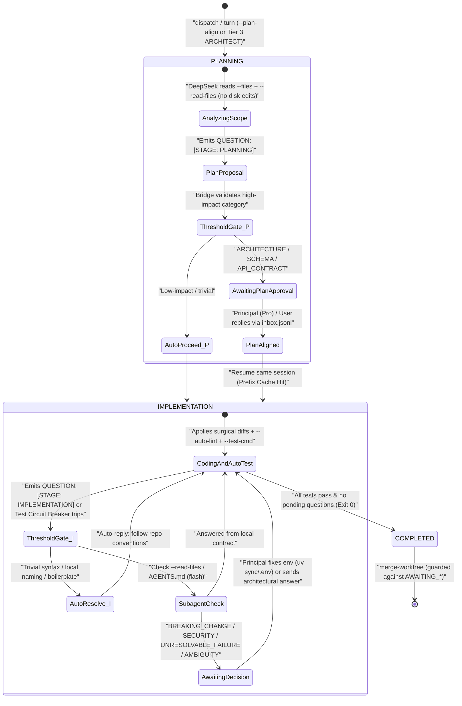

# Specification: Asynchronous Bidirectional Messaging & Decision Escalation Protocol (DeepSeek ↔ Antigravity)

## 1. Executive Summary

In autonomous software engineering, self-contained coding agents often fail when encountering **architectural ambiguity** or **unresolvable environment/regression failures**. Without a consultative loop, models either guess (leading to architectural debt) or silently attempt workarounds that weaken tests.

This specification defines the **Bidirectional Asynchronous Communication Protocol** between DeepSeek (executing via Aider) and the Antigravity Principal Agent.

The system enforces:
1. **2-Stage Proactive Escalation**:
   - **Stage 1 (Planning)**: DeepSeek consults the Principal Agent on data models, boundaries, and trade-offs *before* writing code.
   - **Stage 2 (Implementation)**: DeepSeek self-heals localized bugs via `--test-cmd`, but halts and escalates breaking schema changes, security boundaries, or dependency failures.
2. **Anti-Noise Threshold Gate**: Suppresses trivial/boilerplate questions locally while escalating high-impact architectural choices.
3. **Structured Session IPC (`.aider-sessions/<task_id>/`)**: Manages non-blocking outbox/inbox queues with Antigravity reactive wakeups.
4. **95%+ Prefix Cache Preservation**: Turn 2 resumptions inject only the decision, leaving base prompt tokens byte-identical for DeepSeek hardware KV cache reuse.
5. **Strict Merge Guard (Exit 5)**: Blocks worktree merging if any decision is pending.

---

## 2. The 2-Stage Decision Lifecycle



---

## 3. Anti-Noise Threshold Gate

To protect the Principal Agent from token bloat and trivial interruptions, `aider_bridge.py` applies a deterministic two-layer filter before waking Antigravity:

| Classification | Trigger Signals | Action Taken | Wakes Principal Agent? |
| :--- | :--- | :--- | :---: |
| **`AUTO_SUPPRESS`** *(Trivial / Boilerplate)* | Matches boilerplate sign-offs (*"Should I proceed?"*, *"Should I format docstrings?"*) OR local variable naming. | Auto-replies locally: `"Follow repo conventions and finalize code without conversational sign-off."` | **No** (0 Principal tokens) |
| **`TIER 1: CONTRACT LOOKUP`** | Substantive question whose answer already exists in `--read-files` or `AGENTS.md`. | Ephemeral `flash` worker inspects local spec and injects answer into session. | **No** (Resolved in subagent) |
| **`ESCALATE TO PRINCIPAL`** *(High-Impact)* | • `[STAGE: PLANNING]` with `{ARCHITECTURE, SCHEMA, API_CONTRACT, CONCURRENCY, TRADEOFF}`<br>• `[STAGE: IMPLEMENTATION]` with `{BREAKING_CHANGE, SECURITY, AMBIGUITY, UNRESOLVABLE_FAILURE}`<br>• Test Circuit Breaker tripped (>= 2 failed attempts). | Writes structured event to `.aider-sessions/<id>/outbox.jsonl`, updates `state.json` (`AWAITING_ANSWER`), exits `10` -> Worker subagent pushes `send_message` to Principal. | **Yes** (Consultative Decision) |

---

## 4. Structured Question Contract

DeepSeek is prompted with this strict output contract:

```text
QUESTION: [STAGE: PLANNING|IMPLEMENTATION] [CATEGORY: ARCHITECTURE|SCHEMA|BREAKING_CHANGE|UNRESOLVED_FAILURE] [IMPACT: HIGH]
<Concise technical inquiry explaining what decision is needed and why it impacts the repository>
[OPTIONS:
  A) <Option A description>
  B) <Option B description>
]
[RECOMMENDATION: Option A (Reason)]
```

---

## 5. Structured Session Directory (`.aider-sessions/<task_id>/`)

All session state is tracked in a dedicated directory ignored by git:

```text
.aider-sessions/<task_id>/
├── state.json         # State: RUNNING | AWAITING_PLAN_APPROVAL | AWAITING_DECISION | COMPLETED
├── chat_history.md    # Full conversational history passed to Aider
├── outbox.jsonl       # Structured questions from DeepSeek -> Principal Agent
└── inbox.jsonl        # Answers from Principal Agent -> DeepSeek
```

### Event Schemas

#### `state.json`
```json
{
  "task_id": "auth_refactor_01",
  "stage": "PLANNING",
  "status": "AWAITING_PLAN_APPROVAL",
  "tier": "architect",
  "worktree_path": ".worktrees/auth_refactor_01",
  "branch": "task/auth_refactor_01",
  "turn_count": 1,
  "pending_qid": "q_9f3a12c8",
  "suppressed_count": 0,
  "last_cache_ping_ts": 1795628800
}
```

#### `outbox.jsonl` (DeepSeek -> Principal Agent)
```json
{
  "seq": 1,
  "qid": "q_9f3a12c8",
  "type": "question",
  "stage": "PLANNING",
  "category": "ARCHITECTURE",
  "impact": "HIGH",
  "blocking": true,
  "question": "Token revocation strategy for verify_token(): stateless short-TTL JWT vs Redis-backed JTI blacklist?",
  "options": [
    {"key": "A", "summary": "Stateless 5-min JWT + refresh rotation (zero Redis dependency)"},
    {"key": "B", "summary": "Redis JTI revocation set (instant logout, requires Redis client)"}
  ],
  "recommendation": "A",
  "suppressed": false,
  "ts": "2026-11-25T17:48:00Z"
}
```

#### `inbox.jsonl` (Principal Agent -> DeepSeek)
```json
{
  "reply_to": "q_9f3a12c8",
  "source": "architect",
  "approved_option": "B",
  "answer": "Use Option B (Redis JTI revocation set) — Redis is already provisioned in docker-compose.yml. Inject a RedisClient Protocol so unit tests mock it cleanly.",
  "ts": "2026-11-25T17:48:45Z"
}
```

---

## 6. Prefix Cache Preservation on Turn 2 (`reply`)

When the Principal Agent resolves a question, the subagent invokes:
```bash
python3 scripts/aider_bridge.py reply --task-id "<task_id>" --answer "<Principal's decision>"
```

- **Prefix-Freeze Rule**: The bridge appends *only* `Architect Decision: <decision>. Proceed with implementation.` to the chat history.
- **Zero Invalidation**: `system_rules` is **not** re-prepended on Turn 2+.
- **Result**: Tokens `[0..N]` remain 100% byte-identical, delivering a **95%+ DeepSeek hardware KV cache hit** on resumption.

---

## 7. Strict Safety Merge Guard (Exit 5)

`aider_bridge.py merge-worktree` inspects `.aider-sessions/<task_id>/state.json`. If `status` is `AWAITING_PLAN_APPROVAL` or `AWAITING_DECISION`, it **strictly aborts with exit code 5**, preventing unapproved, ambiguous, or broken code from ever merging into `main`.
